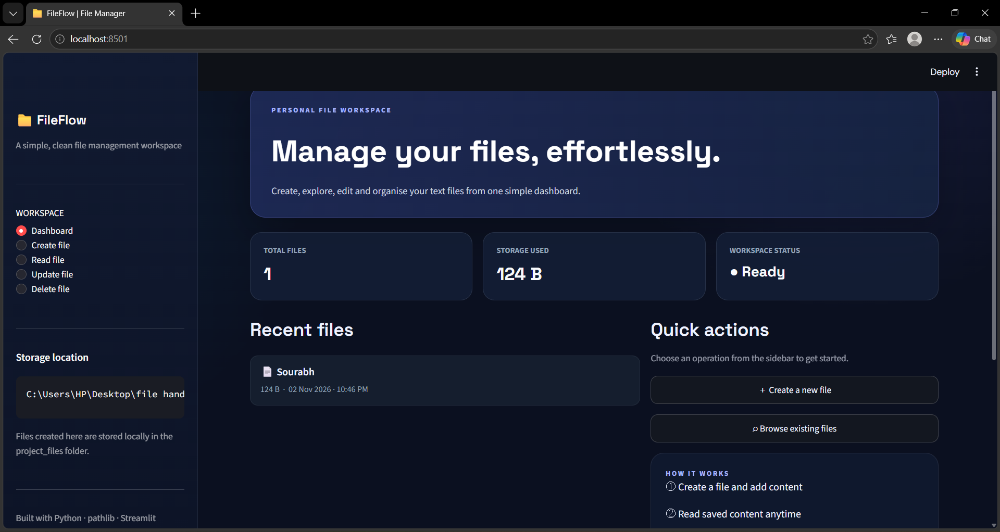
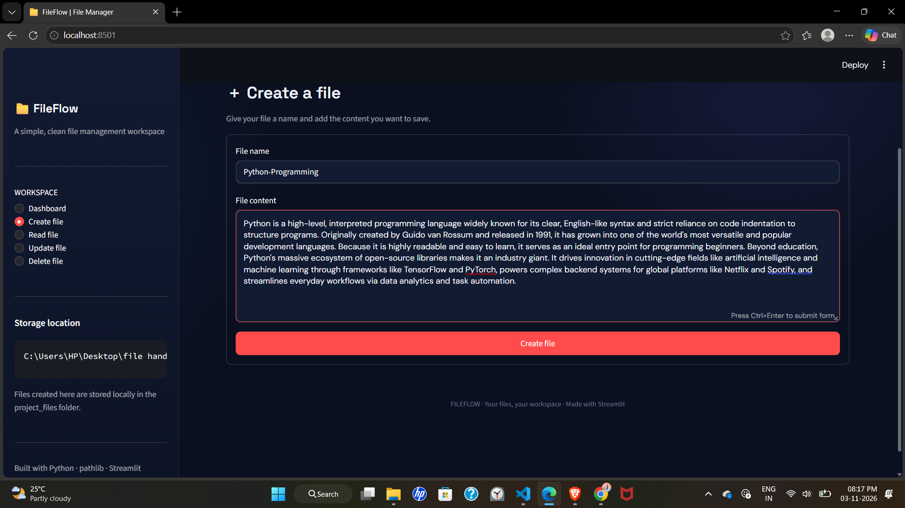
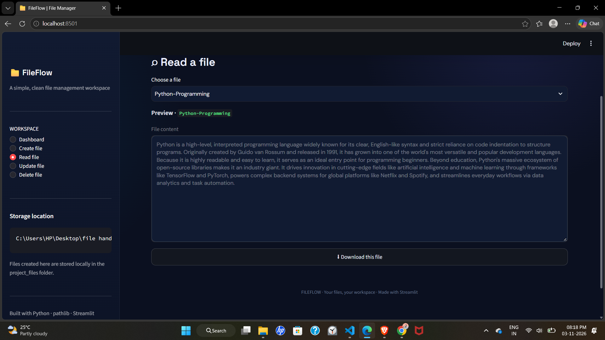
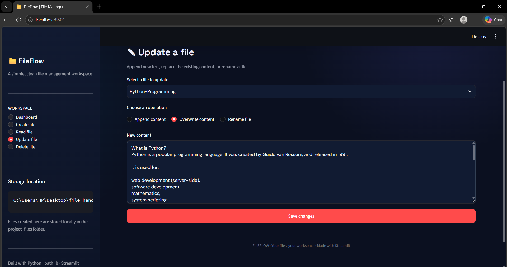
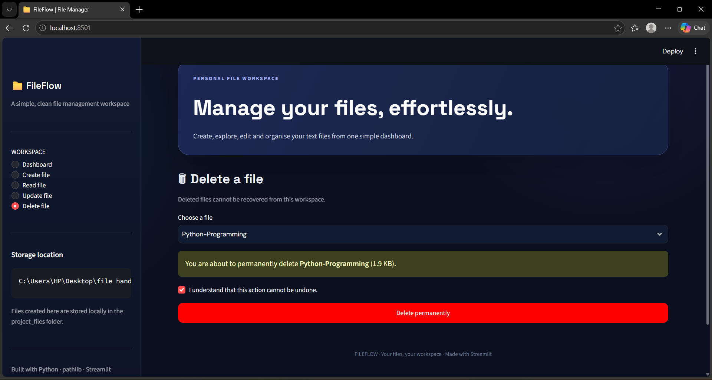

# 📁 FileFlow – Python File Management System

**FileFlow** is a Python-based File Management System built using **Streamlit** that provides a simple, interactive, and user-friendly interface to perform various file-handling operations.

The project demonstrates the practical implementation of Python file handling, exception handling, and the `pathlib` module through a modern web-based dashboard.

## ✨ Features

- **Create Files:** Create new files and write content into them.
- **Read Files:** Open and view the contents of existing files.
- **Update Files:** Append new content, overwrite existing content, or rename files.
- **Delete Files:** Remove unwanted files with a confirmation step.
- **Dashboard:** View total files, storage usage, and recently modified files.
- **Download Files:** Download saved text files directly.
- **Error Handling:** Handle invalid inputs and file-related errors.

## 🛠️ Technologies Used

- Python
- Streamlit
- pathlib
- File Handling (Read, Write, Append)
- Exception Handling

## 🚀 Getting Started

### 1. Clone the repository

```bash
git clone https://github.com/sourabh-76/FileFlow_Python_File_Management.git
```

### 2. Navigate to the project directory

```bash
cd FileFlow
```

### 3. Install dependencies

```bash
pip install streamlit
```

### 4. Run the application

```bash
streamlit run app.py
```

The application will open in your default browser.

## 📂 Project Structure

```text
FileFlow/
│
├── app.py
├── main.py
├── project_files/
└── README.md
```

## 🎯 Project Objective

The main objective of this project is to understand and implement Python file-handling concepts while building an interactive web application using Streamlit.

It combines fundamental Python programming concepts with a clean graphical user interface to make file management easier and more accessible.

## 📸 Application Screenshots

### Dashboard


### Create File


### Read File


### Update File


### Delete File


## 👨‍💻 Author

**Sourabh Singh Rawat**

B.Tech – Artificial Intelligence & Machine Learning

University School of Automation & Robotics (USAR)

---

⭐ If you find this project useful, consider giving the repository a star!
